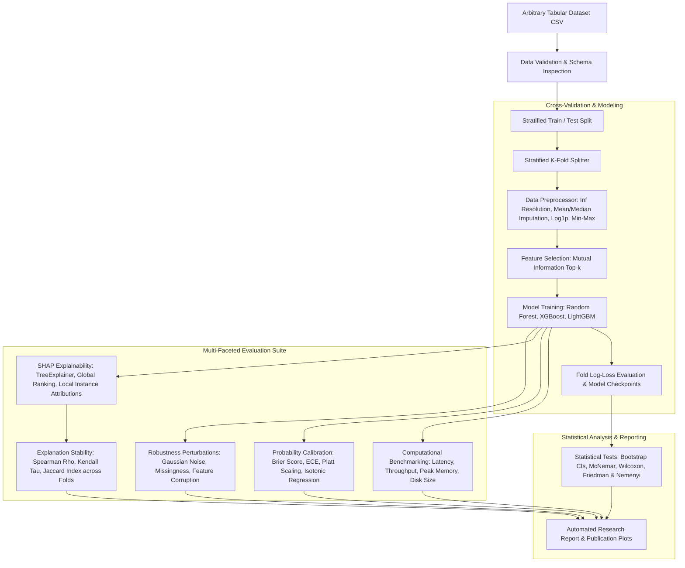

# Architecture: Explainable ML Research Framework

## 1. System Overview

The framework is architected around two decoupled layers:
1. **Generic Tabular ML Engine (`src/`)**: A modular, leak-free, dataset-agnostic pipeline implementing preprocessing, feature selection, ensemble modeling, computational benchmarking, probability calibration, SHAP explanations, explanation stability, robustness perturbations, and non-parametric hypothesis testing.
2. **Dataset Configuration (`config.yaml`)**: A lightweight specification defining data paths, target columns, task mode (binary vs multiclass), feature counts, and model hyperparameters.

No dataset-specific assumptions, hardcoded column names, or attack labels exist in the generic framework.

---

## 2. Mermaid Conceptual Data Flow

---

## 3. Component Separation of Concerns

- **`src/preprocessing/`**: Leak-free scikit-learn transformers. Imputation parameters, skewness transformations, and min-max scalers are fitted strictly on the training partition.
- **`src/feature_selection/`**: Mutual Information-based ranking ($I(f; Y)$) and top-$k$ feature extraction without inspecting test labels.
- **`src/modeling/`**: Standardized `BaseModelWrapper` interface for tree ensembles (Random Forest, XGBoost, LightGBM) with Stratified K-Fold CV fold tracking.
- **`src/benchmarking/`**: Real-time process profiling (`psutil`, `tracemalloc`) measuring peak resident memory, inference throughput, latency, and serialization size.
- **`src/calibration/`**: Probability reliability analysis (Brier score, ECE) comparing uncalibrated predictions against Platt scaling and Isotonic regression.
- **`src/explainability/`**: SHAP feature attributions and multi-fold explanation stability analysis ($\rho$, $\tau$, $J$).
- **`src/robustness/`**: Controlled perturbation testing evaluating model resilience under noise, missingness, and feature corruption.
- **`src/statistics/`**: Non-parametric hypothesis testing providing bootstrap confidence intervals, paired McNemar/Wilcoxon tests, and Friedman/Nemenyi omnibus analysis.
- **`src/reporting/`**: Automated generation of publication-quality figures (300 DPI) and structured research Markdown reports.
